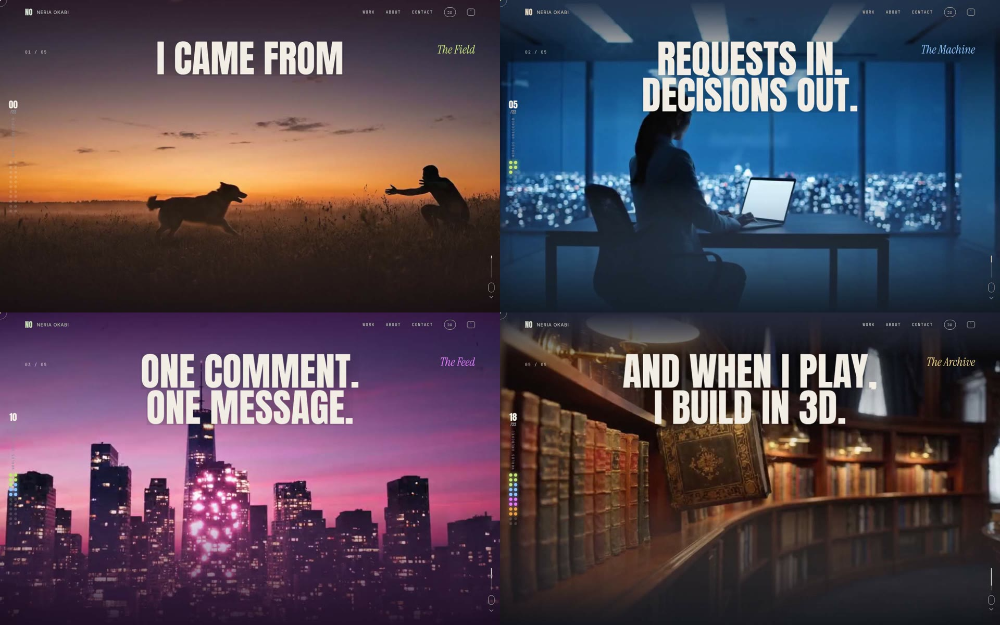

# Neria Okabi · Portfolio

Five projects, told as five cinematic worlds. Scroll drives each scene like a film, the headlines land on the beats, and at the end of every chapter something real falls out of the footage and into the project below it: a tennis ball, a paper plane, a jelly chat bubble, a drop of oil, a torn page.



## The chapters

| # | Project | World | Hand-off into the UI |
|---|---------|-------|----------------------|
| 01 | **Train Your Dog** | Dusk field, a dog runs into its owner's arms | He throws a ball; it bounces out of the scene onto the app's phone |
| 02 | **ProjectHub** | A dark office, ceiling lights run through the building | A sheet folds itself into a paper plane and glides into the dashboard, which starts the approval flow |
| 03 | **NeriaTech Bot** | A city lighting up window by window | A jelly chat bubble rises from a tower, falls onto the phone and pops: the DM arrives |
| 04 | **Dvora-Chen** | Strands of golden oil | A real drop forms on a strand, lets go and lands on the shop's screen |
| 05 | **Library** | An old library at night | A page tears out of a floating book and drifts down onto the app like a leaf |

## How it works

**Scroll-scrubbed video.** Every world is a short filmed clip encoded with a keyframe on every frame (`-g 1`), so any frame can be shown instantly. The playhead eases toward the scroll position on GSAP's ticker, which keeps it smooth on trackpads and phones. Desktop and portrait screens each get their own clip, framed for that shape.

**Seamless hand-offs.** The clip itself carries the object out of the scene, then holds it still for a moment, then ends on a frame where the object has been painted out. A sprite cut from that very frame sits exactly on the held object and takes over, so a lagging video frame never shows the object twice. It only starts moving once the clip shows the painted-out frame, and it is faded exactly like the clip at that height until it leaves the world. From there it is pure motion: gravity, bounces, a leaf-like sway with 3D flutter, a jelly wobble, a curved flight that banks along its path.

**Footage on black, keyed in WebGL.** Objects filmed on a black background (the oil drop, the paper plane) are keyed to transparency in a small WebGL shader with premultiplied alpha, so they float in the page instead of sitting in a box.

**One sky.** A WebGL shader paints the shared background between chapters, so the worlds dissolve into each other with no visible edges.

**Small touches.** Hebrew and English with full RTL, a hidden terminal (press `` ` ``), a custom cursor, reduced-motion support and a HUD that counts the professional worlds you have scrolled through.

## Stack

React 18 · TypeScript · Vite · CSS Modules · Redux Toolkit · GSAP + ScrollTrigger · Lenis · WebGL

## Run it

```bash
npm install
npm run dev      # http://localhost:5173
npm run build    # type-check and build to dist/
```

The footage lives in `public/scenes` and `public/fx`. `scripts/encode-scrub.sh` encodes a new clip for scrubbing.

## Project layout

```
src/
  components/
    Chapter/        one world: pinned stage, scrubbed clip, beats, project panel
    VideoScrub/     scroll-to-playhead easing for a clip
    WorldSky/       the shared WebGL background
    BallBounce/     hand-offs, one per chapter
    PlaneGlide/
    BubbleFall/
    OilFall/
    PageDrift/
    HubAutomation/  interactive project demos
    DmDemo/
    ...
  config/
    content.ts      every project, its story, links and stack
    scenes.ts       which clip each world plays and how its hand-off is timed
  utils/keyer.ts    WebGL black-to-alpha keyer
```

The clips were generated with Google Flow and Gemini, then cut, joined and encoded for scrubbing.

---

[LinkedIn](https://www.linkedin.com/in/neria-okabi) · [GitHub](https://github.com/neriaok)
